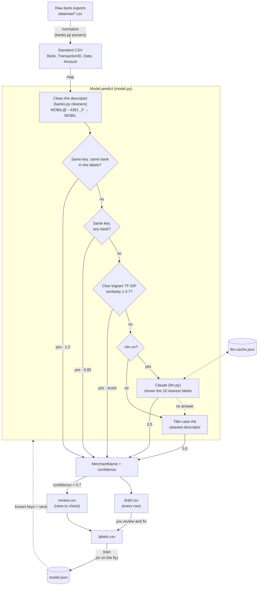

# Architecture

High-level pipeline: raw bank export → `normalize` → standard CSV (`Bank,TransactionID,Date,Amount`) → `map` → labels draft (`Bank,TransactionID,MerchantName`). `TransactionID` is the raw bank description, not an ID.

## The prediction cascade

`map` sends each transaction through a series of steps, cheapest and most
reliable first. The first step that produces an answer wins. Each answer comes
with a confidence score, and anything below `--min-confidence` (default `0.7`)
goes to the review file.

1. **Clean.** The bank's cleaner in `banks.py` removes noise that changes
   between transactions at the same merchant: store numbers, dates, amounts,
   reference codes, transaction-type prefixes (`POS Purchase`) and city
   suffixes. What's left is a stable *key*, for example `MOBIL`.
2. **Exact match.** If a label has the same key from the same bank, use its
   merchant (confidence `1.0`). Otherwise try the same key from any bank (`0.95`).
3. **Similar match.** Compare the key with every labelled key using cosine
   similarity over character trigrams, weighted by TF-IDF. Keys from the same
   bank get a small bonus. If the best score is at least `0.7`, use that
   merchant, with the score as the confidence.
4. **LLM (optional, `--llm`).** Send the raw and cleaned descriptor to Claude,
   along with the 10 most similar labels as examples, so it follows your naming
   style. Claude finishes words the bank cut off (`SUPERMARK` → `Supermarket`)
   and recognises brands (`GOOGLE *YouTube` → `YouTube`). Its answers get
   confidence `0.5`, so they always land in the review file.
5. **Fallback.** Title-case the cleaned key (confidence `0.0`).

Steps 1–3 can only return merchants that already appear in your labels. Most
merchants appear only once, so on a new export many descriptions reach step 4
or 5. That is why the LLM step makes the biggest difference.

## Modules

| File | Role |
|---|---|
| `txmap/banks.py` | Per-bank parsers (export → standard rows), cleaners (descriptor → key) and export detection. |
| `txmap/model.py` | The nearest-neighbour model: training from labels, the cascade above, saving and loading `model.json`. |
| `txmap/llm.py` | The optional Claude step: prompt, structured JSON answer, on-disk cache. Imports `anthropic` only when used. |
| `txmap/cli.py` | The `normalize`, `map`, `train` and `eval` commands. Runs LLM calls 8 at a time. |

## The LLM step

- **Privacy.** With `--llm`, the raw descriptors that reach step 4 and their 10
  nearest labels are sent to the Anthropic API. Nothing is sent without `--llm`.
- **Cache.** Answers are stored in `txmap/data/models/llm-cache.json` (ignored
  by git), keyed by model and descriptor. Each descriptor is sent once. Change
  `PROMPT_VERSION` in `llm.py` to ignore old answers after editing the prompt.
- **Model.** Defaults to `claude-opus-5-5` at low effort. Choose another with
  `--llm-model`, for example `--llm-model claude-haiku-5-5` for lower cost.
- **Setup.** Run `uv sync --extra llm` and set `ANTHROPIC_API_KEY`.

## Measuring it

`txmap eval` splits your labels into 5 folds by key. For each fold, it trains on
the other four and predicts the held-out descriptions. It scores only
descriptions the model hasn't seen, which is the hard case. Add `--llm` to
include step 4. The output breaks accuracy down by cascade step, and `-v` lists
each miss. On the current labels: **60.5%** without the LLM, **79.0%** with it.