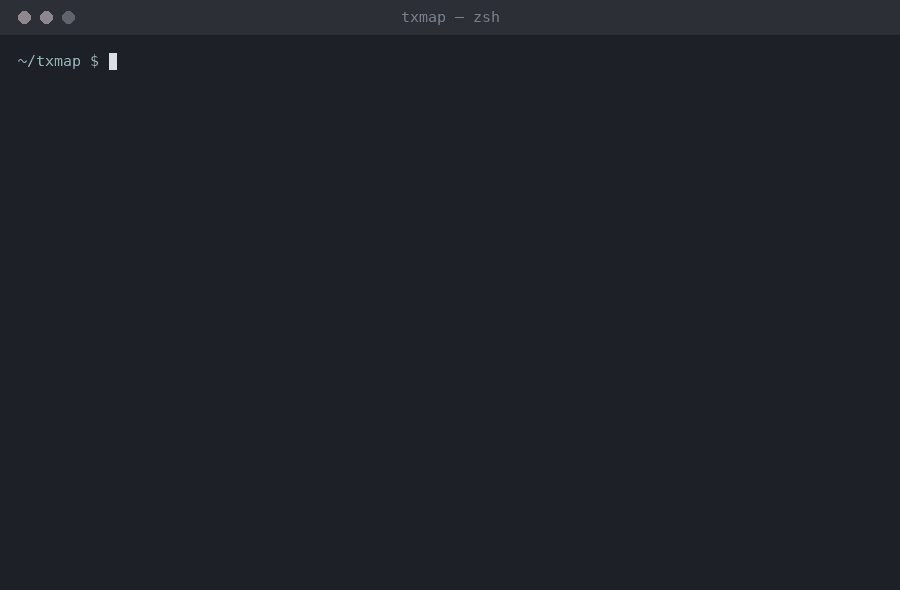
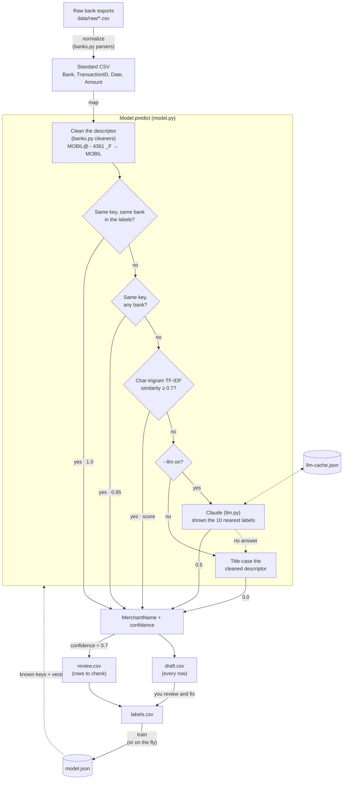

# txmap

`txmap` turns messy bank transaction descriptions into clean merchant names.

Bank exports show cryptic text like `MOBIL@  - 4361    _F` or
`POS Purchase Bulk Barn 476 Mississ`. `txmap` maps each one to a readable
merchant name such as `Mobil` or `Bulk Barn`. It learns from a small set of
labelled examples. It first strips out bank-specific noise like store numbers,
dates and reference codes, then finds the closest match among the examples it
knows. The core is pure Python and has no dependencies. An optional `--llm` mode
asks Claude to name descriptions that have no close match.

Supported banks: **TD Canada Trust** (`td`) and **Meridian Credit Union** (`meridiancu`).

## Demo



The demo runs the whole pipeline on the sample files that ship with the repo:

1. **`normalize`** reads a TD export and a Meridian export, which have
   different formats, and combines them into one standard CSV.
2. **`map`** gives each transaction a merchant name. For example,
   `MOBIL@  - 4361    _F` from TD and `POS Purchase Mobil 4361 Toronto Onca`
   from Meridian both become `Mobil`.
3. **`eval`** measures accuracy on descriptions the model hasn't seen, broken
   down by cascade step. `-v` lists each miss.

The sample labels are tiny, so the accuracy shown (48%) is lower than what
you'll get with your own labels. To re-record the demo, run
`uv run --with pillow python scripts/make_demo_gif.py . docs/demo.gif` (macOS).

## How it works

```
raw bank exports ──normalize──▶ standard CSV ──map──▶ labels draft ──(you review)──▶ labels.csv
```

### 1. `normalize`: raw exports to a standard CSV

**Input:** one or more CSV exports straight from your bank. Every bank uses
different columns. `txmap` recognises the bank from the file's shape, or you can
pass `--bank`.

| Bank | Export format |
|---|---|
| `td` | No header: `Date, Description, Out, In, Balance` |
| `meridiancu` | Header: `ID, Date, Account Name, Description1, Description2, Description3, Amount, Balance` |

Keep raw exports in `txmap/data/raw/`. Git ignores that folder, except for
`*.example.csv` files.

**Output:** one CSV with the same columns for every bank:

```csv
Bank,TransactionID,Date,Amount
td,MOBIL@  - 4361    _F,2026-09-28,-45.10
meridiancu,POS Purchase Bulk Barn 476 Mississ,2026-11-05,-4.92
```

- `TransactionID` is the raw description from the bank.
- `Amount` is negative for money going out.
- `Date` is `YYYY-MM-DD`.

### 2. `map`: standard CSV to a labels draft

**Input:** the standard CSV from `normalize`.

**Output:** each row's bank and description, with a guessed `MerchantName`:

```csv
Bank,TransactionID,MerchantName
td,MOBIL@  - 4361    _F,Mobil
```

This draft uses the same format as a labels file. Check the guesses, fix any
that are wrong, then copy the rows into `txmap/data/out/labels.csv` to teach the
model. `txmap` never writes to `labels.csv` itself.

The tool also reports descriptions it is unsure about. With `--review`, it writes
just those to a separate CSV so you know where to look.

### Training data

Labelled examples are CSV rows of `Bank,TransactionID,MerchantName`. Any extra
columns are ignored.

- `txmap/data/out/labels.example.csv` is a small sample that is committed to git.
- Your own labels go in `txmap/data/out/labels.csv`. Git ignores this file, so your
  transaction history stays private. When it exists, `txmap` uses it by default;
  otherwise it uses the sample.

To start your own file, copy the sample and add rows:

```sh
cp txmap/data/out/labels.example.csv txmap/data/out/labels.csv
```

You can also pass any labels file with `--labels`.

## Architecture



### The prediction cascade

`map` sends each transaction through a series of steps, cheapest and most
reliable first. The first step that produces an answer wins. Each answer comes
with a confidence score, and anything below `--min-confidence` (default `0.7`)
goes to the review file.

1. **Clean.** The bank's cleaner in `banks.py` removes noise that changes
   between transactions at the same merchant: store numbers, dates, amounts,
   reference codes, transaction-type prefixes (`POS Purchase`) and city
   suffixes. What's left is a stable *key*, for example `MOBIL`.
2. **Exact match.** If a label has the same key from the same bank, use its
   merchant (confidence `1.0`). Otherwise try the same key from any bank (`0.95`).
3. **Similar match.** Compare the key with every labelled key using cosine
   similarity over character trigrams, weighted by TF-IDF. Keys from the same
   bank get a small bonus. If the best score is at least `0.7`, use that
   merchant, with the score as the confidence.
4. **LLM (optional, `--llm`).** Send the raw and cleaned descriptor to Claude,
   along with the 10 most similar labels as examples, so it follows your naming
   style. Claude finishes words the bank cut off (`SUPERMARK` → `Supermarket`)
   and recognises brands (`GOOGLE *YouTube` → `YouTube`). Its answers get
   confidence `0.5`, so they always land in the review file.
5. **Fallback.** Title-case the cleaned key (confidence `0.0`).

Steps 1–3 can only return merchants that already appear in your labels. Most
merchants appear only once, so on a new export many descriptions reach step 4
or 5. That is why the LLM step makes the biggest difference.

### Modules

| File | Role |
|---|---|
| `txmap/banks.py` | Per-bank parsers (export → standard rows), cleaners (descriptor → key) and export detection. |
| `txmap/model.py` | The nearest-neighbour model: training from labels, the cascade above, saving and loading `model.json`. |
| `txmap/llm.py` | The optional Claude step: prompt, structured JSON answer, on-disk cache. Imports `anthropic` only when used. |
| `txmap/cli.py` | The `normalize`, `map`, `train` and `eval` commands. Runs LLM calls 8 at a time. |

### The LLM step

- **Privacy.** With `--llm`, the raw descriptors that reach step 4 and their 10
  nearest labels are sent to the Anthropic API. Nothing is sent without `--llm`.
- **Cache.** Answers are stored in `txmap/data/models/llm-cache.json` (ignored
  by git), keyed by model and descriptor. Each descriptor is sent once. Change
  `PROMPT_VERSION` in `llm.py` to ignore old answers after editing the prompt.
- **Model.** Defaults to `claude-opus-5-5` at low effort. Choose another with
  `--llm-model`, for example `--llm-model claude-haiku-5-5` for lower cost.
- **Setup.** Run `uv sync --extra llm` and set `ANTHROPIC_API_KEY`.

### Measuring it

`txmap eval` splits your labels into 5 folds by key. For each fold, it trains on
the other four and predicts the held-out descriptions. It scores only
descriptions the model hasn't seen, which is the hard case. Add `--llm` to
include step 4. The output breaks accuracy down by cascade step, and `-v` lists
each miss. On the current labels: **60.5%** without the LLM, **79.0%** with it.

## Day-to-day commands

Set up the environment (installs Python 3.13 if needed):

```sh
uv sync
```

Normalize raw exports. Pass several files to combine them:

```sh
uv run txmap normalize txmap/data/raw/td-2026-11.csv txmap/data/raw/meridiancu-2026-11.csv -o txmap/data/normalized/all.csv
```

Map them to merchant names, and save the uncertain ones for review:

```sh
uv run txmap map txmap/data/normalized/all.csv -o txmap/data/out/draft.csv --review txmap/data/out/review.csv
```

Add `--llm` to have Claude name descriptions with no close match (needs
`uv sync --extra llm` and `ANTHROPIC_API_KEY`):

```sh
uv run txmap map txmap/data/normalized/all.csv --llm -o txmap/data/out/draft.csv --review txmap/data/out/review.csv
```

Check accuracy on descriptions the model hasn't seen (`-v` lists the misses):

```sh
uv run txmap eval -v
```

Train a model file once and reuse it, instead of retraining on every run:

```sh
uv run txmap train txmap/data/out/labels.csv -o txmap/data/models/model.json
uv run txmap map txmap/data/normalized/all.csv --model txmap/data/models/model.json
```

Run the tests:

```sh
uv run python -m unittest
```

Lint with [ruff](https://docs.astral.sh/ruff/) (installed by `uv sync` as a dev
dependency; settings are under `[tool.ruff]` in `pyproject.toml`):

```sh
uv run ruff check .
uv run ruff check --fix .   # apply the safe automatic fixes
```

Add a dependency:

```sh
uv add <package>
```

## Adding a bank

In `txmap/banks.py`:

1. Write a parser that turns the bank's export rows into standard rows.
2. Write a cleaner that strips the bank's noise from descriptions.
3. Register both in `BANKS`.
4. Teach `detect()` to recognise the bank's export.

Add a sample export as `txmap/data/raw/<bank>.example.csv` and a few rows to
`txmap/data/out/labels.example.csv`.
